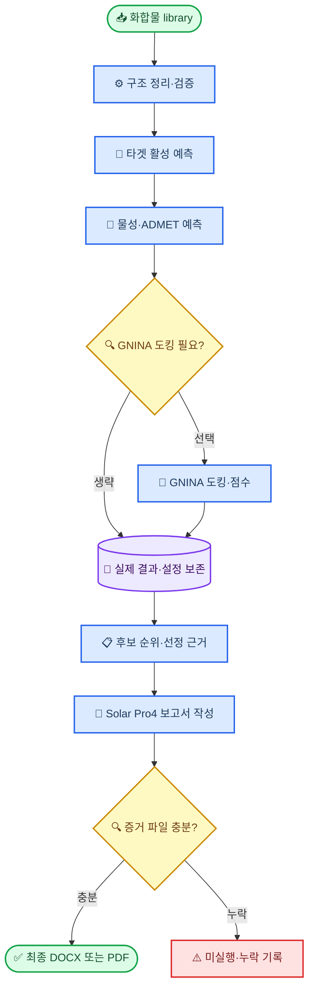

# AI 기반 Virtual Screening 기말 프로젝트

딥러닝/AI 모델을 이용해 화합물 후보를 단계적으로 평가하고, **실제 계산 결과**에 근거해 신약 후보를 우선순위화하는 기말 프로젝트용 저장소입니다. 이 저장소는 Solar Pro4가 `skill/`의 지침과 `experiment/`의 증거 파일을 읽어 최종 보고서를 재현할 수 있도록 설계합니다.

> 현재는 제출용 골격 단계입니다. 질병·타겟·PDB 구조·모델·필터 기준이 확정되기 전에는 예측 수치나 최종 후보를 기록하지 않습니다.

## 프로젝트 목적

- ChEMBL 등에서 확보한 화합물을 정리하고 AI 기반 활성 예측, 물성 및 ADMET 예측, 필요 시 GNINA 도킹으로 후보를 좁힙니다.
- 각 단계의 입력, 설정, 모델 버전, 원본 결과 및 탈락 기준을 보존합니다.
- 최종 보고서는 **Solar Pro4**가 작성하며, 본문은 11pt, 최대 20페이지로 제한합니다.
- 모델 예측은 실험적 약효나 임상 효능의 확정값이 아님을 명확히 합니다.

## 제출 구조

```text
.
├── configs/       # 타겟·모델·경로·시드·필터 설정 템플릿
├── docs/          # 요구사항, 계획 및 의사결정 기록
├── experiment/    # 실제 실행의 입력 목록, 결과 CSV, 도표, 메타데이터
├── report/        # Solar Pro4가 작성한 최종 PDF 또는 DOCX
├── scripts/       # 전처리·예측·통합·시각화 실행 코드
├── skill/         # Solar Pro4 보고서 생성을 위한 지침과 증거 연결표
├── .gitignore
├── README.md
└── requirements.txt
```

`experiment/`, `skill/`, `report/`는 과제의 필수 제출 폴더입니다. 각 역할과 산출물은 [docs/project_requirements.md](docs/project_requirements.md)에 정리했습니다.

## 예정 파이프라인



모든 단계를 반드시 수행할 필요는 없습니다. 선택하지 않은 단계와 그 이유, 실행 실패와 한계도 `experiment/` 및 보고서에 남깁니다.

## 시작 순서

1. [docs/project_plan.md](docs/project_plan.md)의 미확정 항목(질병, 타겟, PDB 구조, 계산 자원)을 결정합니다.
2. `configs/project.template.yaml`을 `configs/project.local.yaml`로 복사하고 실제 경로·시드·임계값을 입력합니다. `project.local.yaml`은 Git에 올리지 않습니다.
3. 원자료의 출처, 추출일, 라이선스와 범위를 `experiment/inputs_manifest.csv`에 기록합니다.
4. 작은 샘플로 스크립트를 검증한 뒤, 실제 결과를 `experiment/`에 보존합니다.
5. `skill/SKILL.md`를 Solar Pro4에 제공해 `report/final_report.docx` 또는 `report/final_report.pdf`를 생성합니다.

## 실제 실행 후 보존할 파일

| 경로 | 내용 |
|---|---|
| `experiment/inputs_manifest.csv` | 원본 데이터 출처·버전·검색 조건·포함 수 |
| `experiment/screening_results.csv` | 분자별 예측값과 모델·실행 식별자 |
| `experiment/filtering_summary.csv` | 각 필터 전후의 후보 수와 탈락 기준 |
| `experiment/candidate_ranking.csv` | 최종 후보 순위와 선정 근거 |
| `experiment/figures/` | Matplotlib로 생성한 보고서용 그림 |
| `experiment/run_metadata.json` | 환경, 모델 버전, 시드, 명령, 설정 파일 해시 |

파일은 실제 실행에서 생성합니다. 골격 단계에서는 빈 파일이나 임의의 점수로 채우지 않습니다.

현재 기록된 실제 실행은 [ADMET-AI 5코어 처리량 벤치마크](docs/benchmark_admet_5core.md)입니다. 이는 후보 선별 결과가 아니라 전체 라이브러리 실행 시간을 판단하기 위한 10,000개 표본 측정입니다.

## 제출 전 확인

- [ ] 질병·타겟 단백질·PDB 구조와 선정 이유가 기록되어 있다.
- [ ] 원자료와 전처리 규칙, 모델 버전, 시드, 필터 기준을 재현할 수 있다.
- [ ] 후보 축소 과정의 실제 결과와 그림·표가 `experiment/`에 있다.
- [ ] `skill/`만 읽고도 Solar Pro4가 증거 파일을 찾아 보고서를 작성할 수 있다.
- [ ] 최종 보고서는 11pt 본문, 20페이지 이하이며 예측과 실험적 사실을 구분한다.

## 보안 및 대용량 파일

API 키, 토큰, 모델 가중치, 원본 대용량 라이브러리, 도킹 중간 산출물은 커밋하지 않습니다. 재현에 필요한 출처·버전·다운로드 방법·파일 해시는 문서와 메타데이터에 기록합니다.
